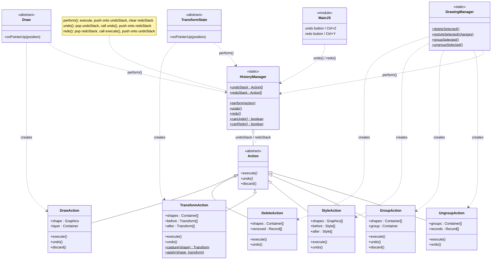

# Command Pattern

**Files:** `actions/Action.js`, `actions/DrawAction.js`, `actions/DeleteAction.js`, `actions/TransformAction.js`, `actions/StyleAction.js`, `actions/GroupAction.js`, `actions/UngroupAction.js`, `managers/HistoryManager.js`, `managers/DrawingManager.js`, `DrawStates/Draw.js`, `DrawStates/TransformState.js`, `main.js`

