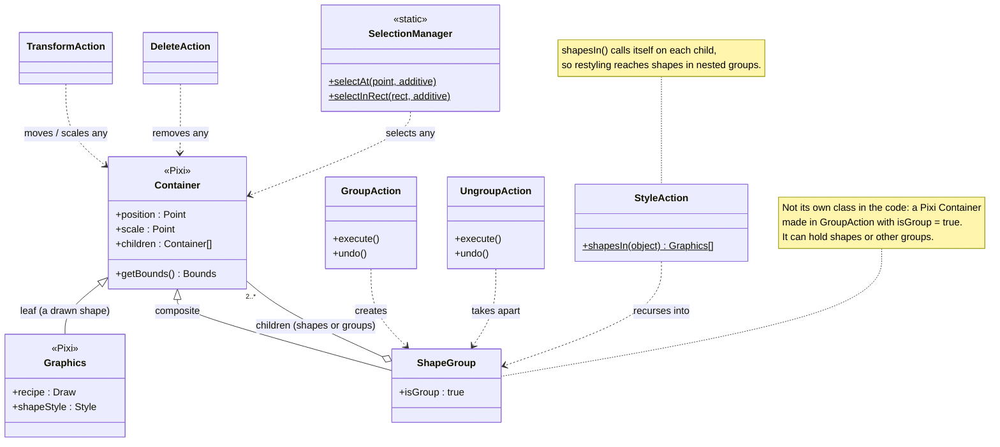

# Composite Pattern

**Files:** `actions/GroupAction.js`, `actions/UngroupAction.js`, `actions/StyleAction.js`, `actions/DeleteAction.js`, `actions/TransformAction.js`, `managers/SelectionManager.js`

