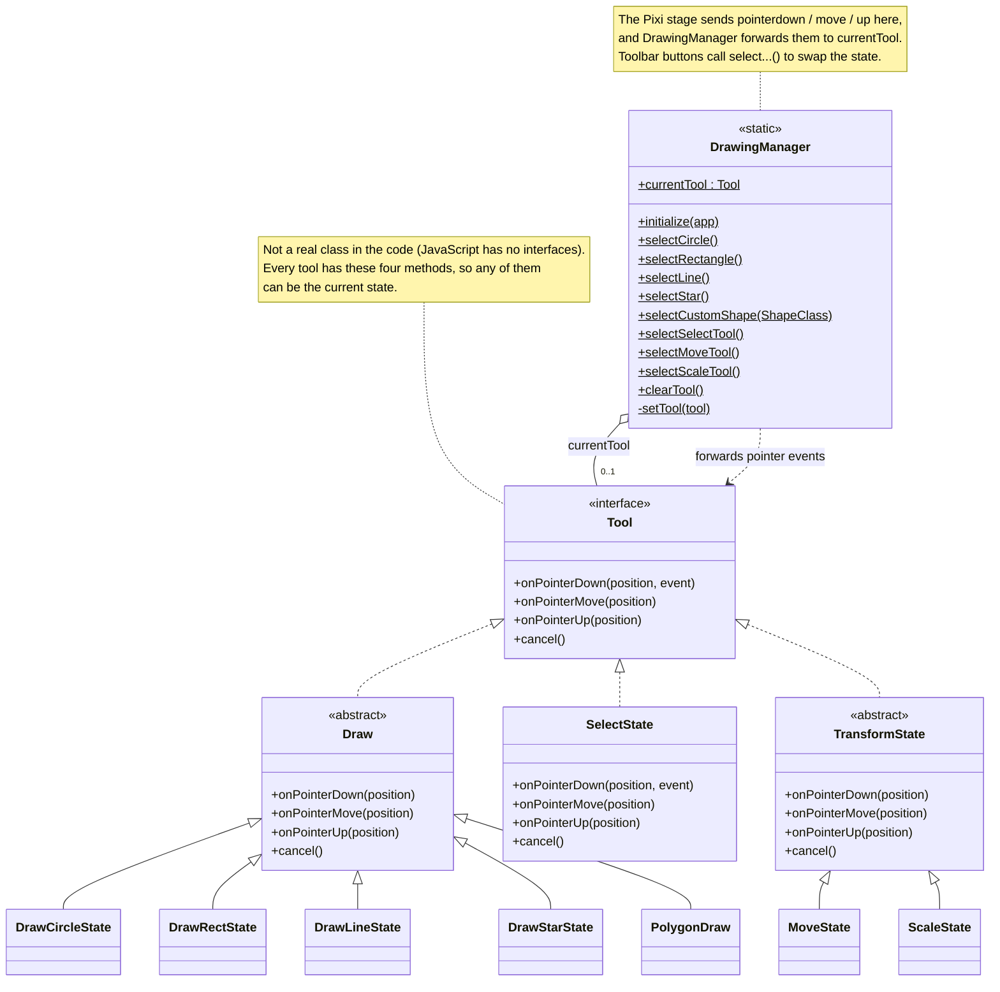

# State Pattern

**Files:** `managers/DrawingManager.js`, `DrawStates/Draw.js`, `DrawStates/SelectState.js`, `DrawStates/TransformState.js`, `DrawStates/MoveState.js`, `DrawStates/ScaleState.js`, and the shape files in `DrawStates/`

