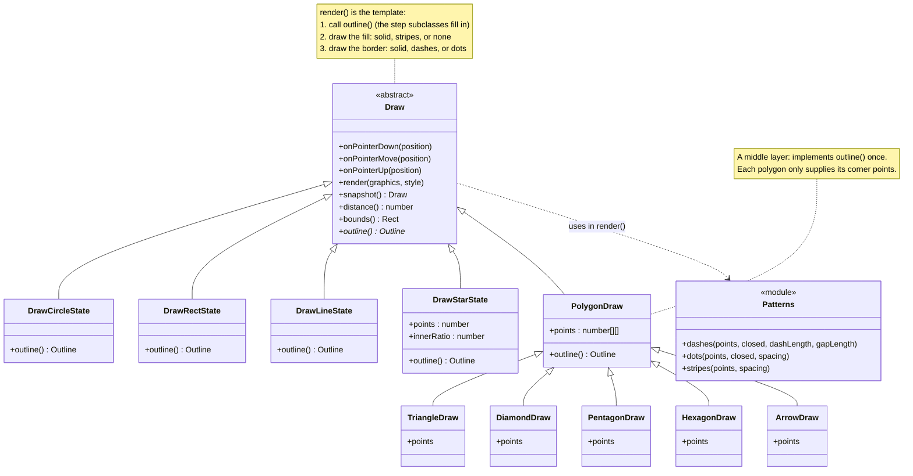
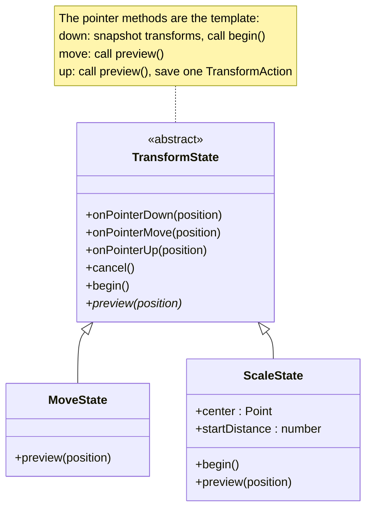

# Template Method Pattern

**Files:** `DrawStates/Draw.js` and every shape file (`CircleDraw.js`, `RectDraw.js`, `LineDraw.js`, `StarDraw.js`, `PolygonDraw.js`), `DrawStates/TransformState.js`, `DrawStates/MoveState.js`, `DrawStates/ScaleState.js`

## Drawing shapes

## Moving and resizing

